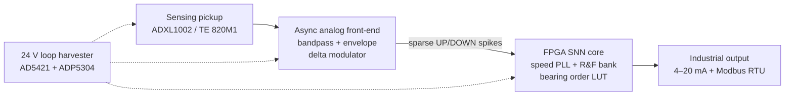

# SpikeGuard

**A speed-adaptive, event-driven bearing-health node for MSME retrofit**

Vishwakarma Awards 2026–27 · Stage 2 submission · Team ID `VK26-IITI-AHM-0453` · Track: Predictive Maintenance & Machine Diagnostics

SpikeGuard is a 2-wire, 4–20 mA loop-powered bearing-health node for legacy variable-speed induction motors. Instead of continuous kHz ADC sampling and FFT processing, it converts vibration into sparse UP/DOWN spikes with an analog delta modulator and classifies them with a multiplier-free Resonate-and-Fire spiking neural network (SNN) on a small FPGA. Motor speed is recovered from the vibration itself, so no tachometer is needed.

<p align="center">
  
</p>

> Figures in this repository are design-stage targets and simulation results from the Stage 2 submission. Bench measurements follow in the fabrication phase (see [Roadmap](#roadmap)).

## Project status
Full proposal: [docs/SpikeGuard_Proposal.pdf](docs/SpikeGuard_Proposal.pdf)
| Area | Status |
| --- | --- |
| Mechanical design (CAD) | Complete: [`hardware/cad`](hardware/cad) |
| Schematic and BOM | Complete: [`hardware/schematic`](hardware/schematic), [`hardware/bom`](hardware/bom), [`docs/bom.md`](docs/bom.md) |
| Simulation and FEA | Done at design stage (estimates, not bench measurements) |
| PCB fabrication, bring-up, bench and field testing | Planned, Nov 2026 – Feb 2027 |

## How it works



Details: [`docs/architecture.md`](docs/architecture.md)

## Key specifications

| Subsystem | Selection | Target |
| --- | --- | --- |
| Vibration pickup | Analog Devices ADXL1002 (or TE 820M1 piezo) | ±50 g, 21 kHz resonance, 25 µg/√Hz noise |
| Analog front-end | TI TLV9042 + TLV3691 | 10 µA op-amp bandpass and envelope, 75 nA comparator as delta modulator |
| Neuromorphic core | Lattice iCE40UP5K (Gowin GW1NR-9 for prototype) | ~1,450 LUT4s, 0 DSP multipliers, under 5 µs per spike event |
| Speed adaptation | Hardware digital PLL + bearing order LUT | 300–3,600 RPM tacholess, ±1.5% slip tolerance |
| Industrial output | ADI AD5421 + TI THVD1400 | 16-bit 4–20 mA loop DAC, RS-485 Modbus RTU |
| Power | 24 V current-loop harvester | Total budget under 9.1 mW, FPGA SNN compute under 1.8 mW |
| Fault signalling | NAMUR NE43 | Loop pulled to 3.6 mA or lower on sensor or wire fault |

## Safety and standards

Surge and miswiring protection, thermal and EMI isolation, and a loop-current governor protect both the node and the plant PLL. Loop current maps to ISO 20816-3 severity zones (4 mA healthy, 12 mA warning, 20 mA critical trip), and NAMUR NE43 fault levels keep a dead sensor from looking healthy. Full detail, with design targets for IP67 and IEC 61000-4: [`docs/safety-and-standards.md`](docs/safety-and-standards.md)

## Roadmap

| Month | Milestone |
| --- | --- |
| Nov 2026 | Component sourcing and PCB fabrication |
| Dec 2026 | Bench bring-up: assemble, CNC baseplate, validate loop power and delta-modulator thresholds |
| Jan 2027 | Prototype demo: load SNN bitstream, record fault-alarm video (Stage 3 submission) |
| Feb 2027 | Field test on a shop-floor induction motor, tune speed-adaptive tracking |

## Repository layout

```text
SpikeGuard/
├── README.md
├── LICENSE
├── hardware/
│   ├── cad/            Autodesk Fusion 3-tier assembly (SpikeGuard_CAD.f3z)
│   ├── schematic/      Mixed-signal schematic source (Schematic.sch)
│   └── bom/            BOM export from the schematic (Schematic.csv)
└── docs/
    ├── architecture.md
    ├── safety-and-standards.md
    ├── bom.md          Prototype bill of materials with costs and lead times
    └── images/         Renders and schematic preview used in this README
```

## Opening the design files

- `hardware/cad/SpikeGuard_CAD.f3z`: open in Autodesk Fusion.
- `hardware/schematic/Schematic.sch`: open in Autodesk Fusion Electronics. A PNG preview is in `docs/images/schematic.png`.

## Schematic preview


## License

MIT, see [`LICENSE`](LICENSE).
