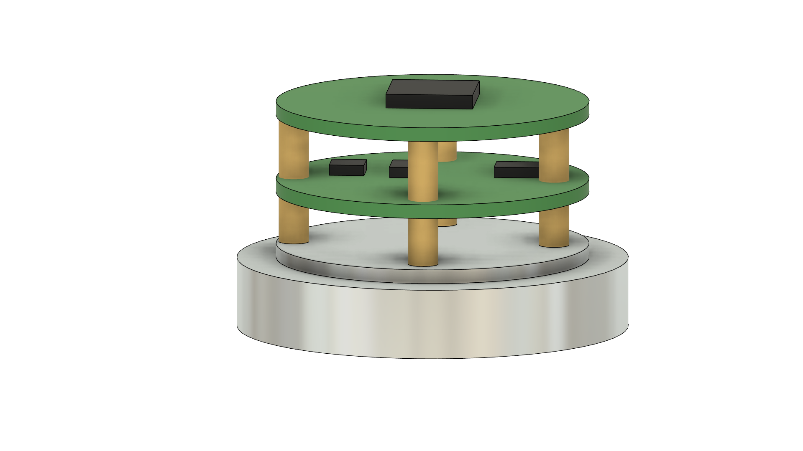
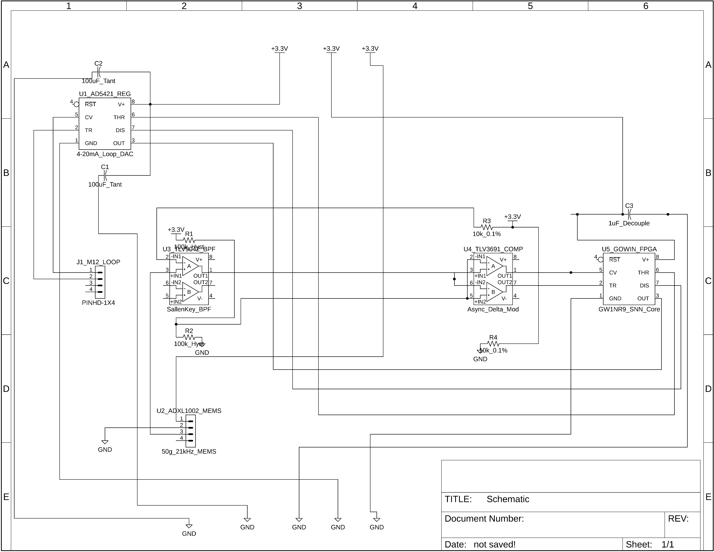

# SpikeGuard: Speed-Adaptive, Event-Driven Bearing-Health Retrofit Node

**Vishwakarma Awards 2026–27 | Stage 2 Submission**  
**Team ID / Application ID:** `VK26-IITI-AHM-0453`  
**Track:** Predictive Maintenance & Machine Diagnostics  

---

## 📌 Core Innovation Summary
SpikeGuard is a 2-wire, 4–20 mA loop-powered, tacholess neuromorphic bearing-health retrofit node designed specifically for legacy variable-speed induction motors in Indian MSMEs. By replacing power-hungry continuous ADCs and FFT processors with a micropower **analog delta modulator** and a **multiplier-free Resonate-and-Fire SNN core** implemented on an ultra-low-power FPGA, SpikeGuard operates continuously within a strict **<9.1 mW loop-powered energy budget**.

---

## 🖼️ Project Visuals & Hardware Architecture

### 1. 3D Mechanical Assembly (3-Tier Circular Stack)
*Engineered with a CNC-turned Al 6061-T6 acoustic baseplate and dual FR4 carrier tiers isolated via M3 brass standoffs.*

### 2. Mixed-Signal Circuit Schematic
*Optimized schematic featuring the AFE, analog delta modulator, AD5421 loop regulator, and Gowin FPGA core.*

---

## 📂 Repository Asset Manifest
* **`SpikeGuard_CAD.f3z`** — Autodesk Fusion parametric 3-tier mechanical assembly archive.
* **`Schematic.sch` & `Schematic.csv`** — Mixed-signal schematic source file and bill of materials export.
* **`SCHEMATIC.png`** — Cleaned vector-quality schematic export for presentation and documentation.
* **`spikeguard_final1.png`** — High-resolution 3D isometric render of the sensor node housing.

---

## ⚡ Technical Specifications & PPA Highlights
| Subsystem | Selected Component / Protocol | Performance Metric |
| :--- | :--- | :--- |
| **Vibration Pickup** | Analog Devices ADXL1002 | Plus/minus 50g range, 21 kHz resonance, 25 micro-g per root-Hz noise floor |
| **Analog Front-End** | TI TLV9042 + TLV3691 | 10 micro-Amp op-amp bandpass + continuous-time delta modulation |
| ~~~Neuromorphic Core~~~ | Lattice iCE40UP5K / Gowin GW1NR-9 | ~1,450 logic units, 0 DSP multipliers, <1.8 mW active SNN compute |
| **Speed Adaptation** | Hardware Digital PLL + Bearing Order LUT | Tacholess order-tracking across plus/minus 1.5 percent slip |
| **Industrial Output** | ADI AD5421 + THVD1400 | 16-bit 4 to 20 mA loop DAC plus isolated RS-485 Modbus RTU |

---

## 🛡️ Safety & Standards Compliance
* **ISO 20816-3:** Direct mapping of SNN spike rates to industrial rotating machinery vibration severity zones (4 mA Healthy, 12 mA Warning, 20 mA Critical Trip).
* **NAMUR NE43:** Hardware burnout diagnostics pull loop current to 3.6 mA or lower upon sensor drift or wire break.
* **IP67 Ingress & IEC 61000-4:** Viton O-ring sealed cylindrical aluminum housing and M12 connector rated against shop-floor coolants and Level 3/4 EMC surges.

---
