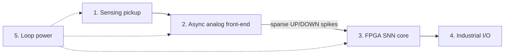

# Architecture

SpikeGuard replaces a conventional "ADC → FFT → threshold" chain with an event-driven chain. Nothing is digitized continuously: the analog front-end emits spikes only when the vibration envelope changes, and the FPGA does work only when a spike arrives.

## Stages

| # | Stage | Parts | Role |
| --- | --- | --- | --- |
| 1 | Sensing pickup | ADI ADXL1002 (MEMS) or TE 820M1 (piezo) | Wideband vibration pickup, 0.5–11 kHz flat response, 25 µg/√Hz noise floor. Coupled through a stiff magnetic base or M8 stud. |
| 2 | Async analog front-end | TI TLV9042 + TLV3691 | Bandpass and envelope detector demodulate the impact carrier; a level-crossing comparator acts as a delta modulator and outputs sparse UP/DOWN spikes. |
| 3 | FPGA SNN core | Lattice iCE40UP5K (Gowin GW1NR-9 for prototype) | Tacholess speed PLL locks to the 1× shaft fundamental (5–60 Hz). An order-locked Resonate-and-Fire bank of 8 multiplier-free neurons is tuned to BPFO, BPFI, BSF and FTF with ±1.5% slip damping. A bearing order LUT holds selectable bearing ratios (DIP switch or Modbus). |
| 4 | Industrial I/O | ADI AD5421 + TI THVD1400 | 16-bit 4–20 mA loop output and RS-485 Modbus RTU. |
| 5 | Loop power | AD5421 REGOUT + ADP5304 buck | Harvests power from the 24 V current loop for all stages. Tantalum reservoir capacitors ride through high-spike-rate EMI bursts. |

## Why event-driven

- No always-on kHz ADC, so idle power stays low.
- No fixed-frequency FFT bins, so VFD speed changes and 1–2% roller slip do not smear defect harmonics.
- Multiplier-free neurons: about 1,450 LUT4s, no DSP blocks, under 5 µs per spike event instead of 100+ ms FFT frame buffering.

## Mechanical stack

Three-tier circular stack, bottom to top:

1. CNC-turned aluminium acoustic baseplate with integral M8 mounting stud (Al 7075-T6 per the BOM).
2. Four M3 hex brass standoffs (15 mm): grounded interconnect and thermal decoupling of the FPGA from the MEMS sensor.
3. Two Ø36 mm × 1.6 mm FR4 discs: mixed-signal AFE tier and digital processing tier.

The CAD source is in [`hardware/cad`](../hardware/cad) and the schematic in [`hardware/schematic`](../hardware/schematic).

## Power

Total node budget is under 9.1 mW from a 2-wire 4–20 mA loop. The FPGA SNN compute portion is under 1.8 mW. These are design targets pending bench measurement.
